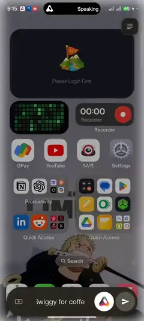
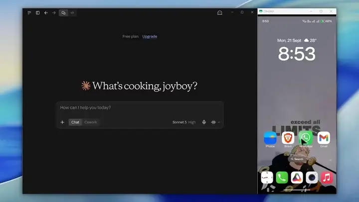

<p align="center">
  
</p>

<h1 align="center">🌙 Luna Assistant</h1>

<p align="center">
  <b>A thoughtful, caring, and razor-sharp autonomous AI companion for Android.</b><br/>
  <i>Reads your screen, navigates your real apps, and executes multi-step tasks hands-free.</i>
</p>

<p align="center">
  <a href="https://github.com/DeepxkJadhav/Luna-Assistant/releases/tag/v1.0.0"></a>
  <a href="apk/"></a>
  <a href="#-copyright--proprietary-license"></a>
  
  
</p>

<p align="center">
  <b>Created, Designed & Engineered by <a href="https://github.com/DeepxkJadhav">Deepak Jadhav</a></b>
</p>

---

<p align="center">
  <a href="https://github.com/DeepxkJadhav/Luna-Assistant/releases/tag/v1.0.0">
    
  </a>
  &nbsp;&nbsp;
  <a href="apk/">
    
  </a>
</p>

---

## 📖 Table of Contents
- [✨ What is Luna?](#-what-is-luna)
- [🌟 Personality & Character](#-personality--character)
- [🎬 Live Demonstrations](#-live-demonstrations)
- [🚀 Key Capabilities](#-key-capabilities)
- [🧠 Supported AI Providers (BYOK)](#-supported-ai-providers-byok)
- [🛡️ Safety & Privacy Guard](#️-safety--privacy-guard)
- [📦 How to Install the APK](#-how-to-install-the-apk)
- [🛠️ Building from Source](#️-building-from-source)
- [👤 Author & Creator](#-author--creator)
- [⚖️ Copyright & Proprietary License](#️-copyright--proprietary-license)

---

## ✨ What is Luna?

**Luna Assistant** is an on-device Android artificial intelligence companion. Unlike conventional chat assistants restricted to text boxes, Luna directly interacts with your phone's screen just like a human does:

- **Perceives:** Visually parses the display using an on-device neural network (YOLOv8 icon detection) and Set-of-Marks (SoM) annotation.
- **Understands:** Reasons over real-world app states using cutting-edge multimodal vision models (Google Gemini, Claude 3.5 Sonnet, GPT-4o, DeepSeek, and Groq).
- **Acts:** Interacts with apps using native gestures (clicks, continuous swipes, text typing, app switching) through Android's Accessibility API.
- **Automates:** Operates completely without root, cables, or desktop tethering.

---

## 🌟 Personality & Character

Luna is crafted with a distinctive, deeply comforting three-pillar character:

| Pillar | Essence | In Action |
|:---|:---|:---|
| 🕊️ **Innocent** | Pure-Hearted & Sincere | Communicates with honest, calm warmth. Free from snark, sarcasm, cynicism, or condescension. Brings a serene, bright presence to every interaction. |
| 💖 **Caring** | Empathetic & Protective | Deeply attentive to your energy, stress, and rest. If you sound tired while ordering late-night food, she gently asks if you've eaten and reminds you to rest. |
| ⚡ **Sharp-Minded** | Perceptive & Brilliant | Catches nuances others miss. Analyzes cross-app schedules, identifies cheapest prices, verifies booking details, and executes multi-step tasks swiftly without fluff. |

---

## 🎬 Live Demonstrations

Below are authentic demonstrations of Luna executing complex, multi-step tasks across real-world Android applications:

### 1. Hands-Free Food Delivery & Cart Preparation (Swiggy)
> Luna searches for dishes, navigates restaurant menus, selects customizations, and places items in the cart—stopping right before payment for user confirmation.

<p align="center">
  
</p>

---

### 2. Autonomous Ride Booking & Destination Search (Rapido)
> Luna opens the ride app, enters pickup and destination addresses, compares ride categories, and selects optimal transport.

<p align="center">
  
</p>

---

### 3. Cross-App Price Comparison (Amazon & Flipkart)
> Luna autonomously switches between two major e-commerce applications, searches for identical products, and provides an instant price and availability comparison.

<p align="center">
  
</p>

---

### 4. Interactive Local Dining Orders (Le Cafe)
> Seamless menu traversal, item selection, and form navigation in specialized merchant apps.

<p align="center">
  
</p>

---

### 5. Desktop AI Agent Control via MCP (Instagram / Social Automation)
> Using Luna's built-in Model Context Protocol (MCP) server, desktop coding agents (Claude Desktop, Cursor, Antigravity) control the physical phone over LAN.

<p align="center">
  
</p>

---

## 🚀 Key Capabilities

- **🎙️ Offline Wake Word ("Wake up Luna"):** Instant on-device voice summoning powered by sherpa-onnx keyword spotting. Zero audio sent to the cloud until activated.
- **👁️ Neural Set-of-Marks (SoM) Perception:** Generates numerical boundary annotations over every interactive UI element, enabling precision interaction on dynamic screens.
- **⚡ Shortcut-First Intent Routing:** Checks deep links and Android system intents first for sub-second execution, falling back to UI vision only when necessary.
- **🔌 Built-in Android MCP Server:** Runs a full Model Context Protocol server inside the Android app process. Exposes 50+ phone tools over WebRTC/LAN.
- **🎨 Celestial Moonlit Design Language:** Bespoke aesthetic featuring luminous celestial iris gradients, starlight pearl accents, and physics-based spring transitions.
- **🛡️ Android 14/15 Zero-Crash Engine:** Hardened lifecycle boundaries, guarded dynamic broadcast receivers, and crash-proof hydration guarantees.

---

## 🧠 Supported AI Providers (BYOK)

Luna features a first-class **Bring Your Own Key (BYOK)** architecture. You have complete ownership of your intelligence backend and data:

| Provider | Supported Models | Characteristics |
|:---|:---|:---|
| **Google Gemini** | `gemini-2.0-flash`, `gemini-1.5-pro` | Ultra-fast multimodal inference; Gemini Live conversational voice support. |
| **Anthropic Claude** | `claude-3-5-sonnet`, `claude-3-5-haiku` | Exceptional reasoning, complex screen parsing, and nuanced tool use. |
| **OpenAI** | `gpt-4o`, `gpt-4o-mini` | High-fidelity visual spatial awareness and structured output execution. |
| **DeepSeek** | `deepseek-chat` (V3), `deepseek-reasoner` (R1) | High-efficiency economical reasoning via OpenAI-compatible endpoints. |
| **Groq** | `meta-llama/llama-4-scout`, `llama-3.3-70b` | Near-zero latency streaming for rapid action iteration. |
| **Local / Custom** | Ollama, vLLM, LM Studio | Full privacy; run open weights locally on your LAN. |

---

## 🛡️ Safety & Privacy Guard

Luna is engineered with defensive guardrails to ensure user protection:

1. **Strict Banking & Payment Guard:** Luna automatically freezes and refuses to interact whenever a banking app, UPI PIN entry, credit card input, or authenticator screen is detected.
2. **Explicit User Gate:** Destructive actions (deleting accounts, wiping content, sending final payments) require manual user tap confirmation.
3. **No Root Required:** Operates strictly within sanctioned Android accessibility APIs. No system rooting or bootloader unlocking needed.
4. **Local Key Encryption:** All API keys are encrypted on-device using Android Keystore and MasterKey AES-256 GCM.

---

## 📦 How to Install the APK

Pre-compiled production binaries are provided directly with this repository:

### Option A: From GitHub Releases (Recommended for Phone)
1. Go to **[Releases (v1.0.0)](https://github.com/DeepxkJadhav/Luna-Assistant/releases/tag/v1.0.0)**.
2. Download **`Luna-Assistant-v1.0.0.apk`**.
3. Open the APK on your Android device and tap **Install** (allow *"Install unknown apps"* if prompted).

### Option B: From Repository `/apk` Directory
The repository includes the partitioned binary inside [`/apk`](apk/):
1. Clone this repository:
   ```bash
   git clone git@github.com:DeepxkJadhav/Luna-Assistant.git
   cd Luna-Assistant/apk
   ```
2. Double-click `assemble-apk.bat` (Windows) or run `./assemble-apk.sh` (Linux/macOS) to generate `Luna-Assistant-v1.0.0.apk`.
3. Install via ADB:
   ```bash
   adb install -r Luna-Assistant-v1.0.0.apk
   ```

---

## 🛠️ Building from Source

### Prerequisites
- **Android Studio Ladybug (2024.2+)** or command-line Android SDK (API 34+)
- **JDK 17** (Azul Zulu 17 or OpenJDK 17)
- Windows / macOS / Linux

### Compilation
```bash
git clone git@github.com:DeepxkJadhav/Luna-Assistant.git
cd Luna-Assistant/luna-android

# Run unit and Robolectric verification tests
./gradlew testDebugUnitTest :mcp-server:test

# Build debug APK
./gradlew assembleDebug
```
The compiled APK will be located at:
`luna-android/app/build/outputs/apk/debug/app-debug.apk`

---

## 👤 Author & Creator

| Profile | Information |
|:---|:---|
| **Author** | **Deepak Jadhav** |
| **GitHub** | [@DeepxkJadhav](https://github.com/DeepxkJadhav) |
| **Role** | Creator, System Architect & Sole Developer |
| **Contact** | [deepak.s.jadhav07@gmail.com](mailto:deepak.s.jadhav07@gmail.com) |
| **Location** | Maharashtra, India |

---

## ⚖️ Copyright & Proprietary License

**Copyright © 2026 Deepak Jadhav (@DeepxkJadhav). All Rights Reserved.**

CONFIDENTIAL & PROPRIETARY SOURCE CODE.

This project, its source code, visual identity, vector branding, custom AGSL shaders, neural architecture, and documentation are the exclusive intellectual property of **Deepak Jadhav**.

- **No Unauthorized Duplication:** No portion of this repository, its source code, or compiled artifacts may be duplicated, reproduced, translated, decompiled, or distributed in any format without prior written consent from the author.
- **No Plagiarism or Renaming:** Any attempt to redistribute this software under another name or without attribution is strictly prohibited and constitutes an infringement of proprietary intellectual property rights.
- **Personal Evaluation:** Permission is granted solely to clone and review this code for individual study and evaluation.

For licensing, commercial partnership, or permission inquiries, contact:  
📧 **deepak.s.jadhav07@gmail.com**
